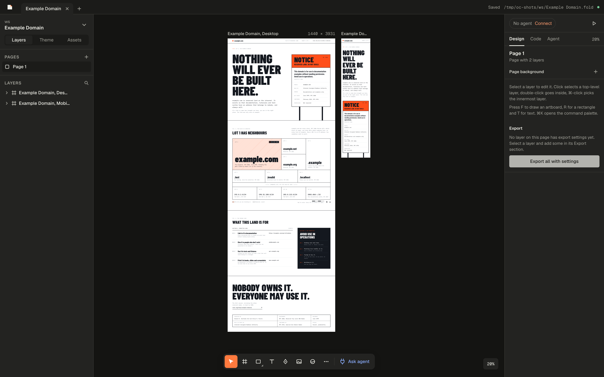
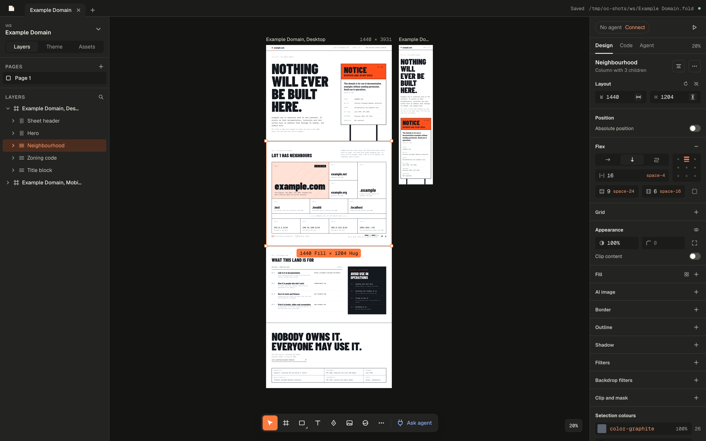
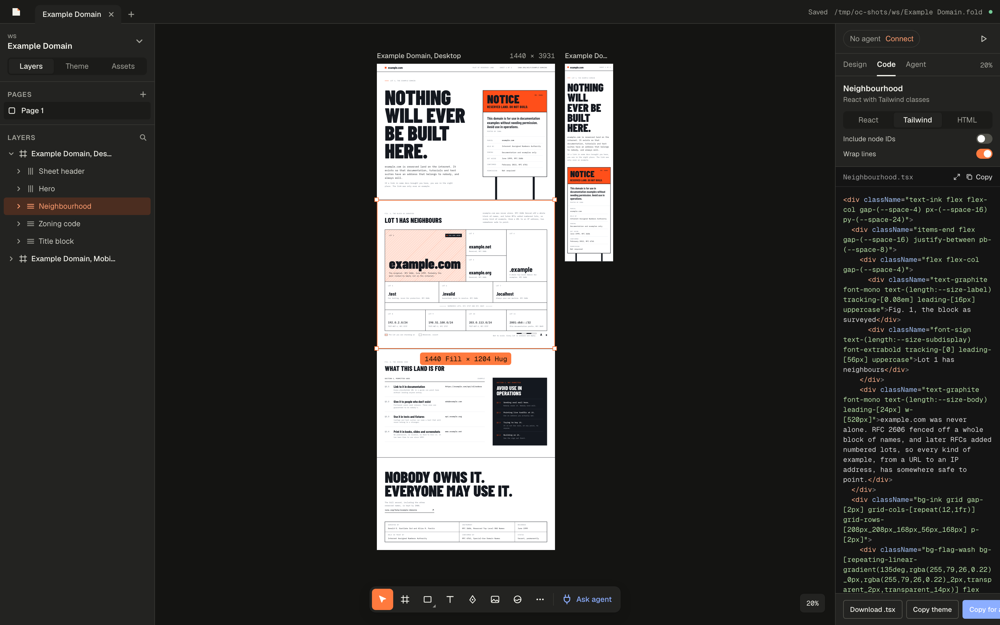

# OpenCrease

A free, local-first design tool where the canvas is real HTML and CSS. Draw editable layouts, export working markup, and let agents read and write your designs over MCP.

OpenCrease is an independent, clean-room project inspired by [Paper](https://paper.design), with compatible MCP tool names and shapes. Early v0.1: single user, files on your disk, no account.



| Design panel | Code export |
| --- | --- |
|  |  |

## Download

Get the macOS app (Apple Silicon or Intel) from [Releases](https://github.com/tinsever/opencrease/releases). Builds aren't notarized yet: the first time you open the app, macOS blocks it. Go to System Settings → Privacy & Security and click Open Anyway. On other platforms, run from source as described below.

## Quick start

Requirements: Node 22 or newer and pnpm 10.

```sh
pnpm install
pnpm --filter @opencrease/editor build
pnpm start                         # http://127.0.0.1:29880
pnpm start ~/Designs               # use another workspace
```

The default workspace is `~/Documents/OpenCrease`. The server opens your browser and signs the editor in automatically.

## Connect an agent

Open **Connect an agent** for setup commands for Claude Code, Codex, Cursor, VS Code, Zed and OpenCode. Keep the editor open while the agent works, or use headless MCP below.

Claude Code over stdio, from a source checkout:

```sh
claude mcp add opencrease -- node /path/to/opencrease/apps/server/bin/opencrease.mjs mcp
```

`opencrease mcp` starts the server when needed and discovers authentication automatically. Streamable HTTP clients connect to `http://127.0.0.1:29880/mcp` with `Authorization: Bearer <token>`; Connect an agent also provides authenticated URL commands for clients without header configuration.

The credential is saved in `$OPENCREASE_HOME/token` (default `~/.opencrease/token`, owner-only permissions) and stays valid across restarts and ports. **Settings → Agents → Reset token** rotates it. Update connected HTTP clients and the Snapshot extension after a reset; stdio discovers the new token automatically. `OPENCREASE_TOKEN` is an explicit override and must be changed at its source.

New agent clients need your approval once. Manage access in Settings → Agents. Agents load a layered design guide, post a brief, build in small steps and review screenshots. Edit the built-in guide's user/file overrides and required steps in Settings → Design guide. See [quality checks](docs/QUALITY.md).

## Features

### Canvas and layout

Real DOM layers support flex, CSS Grid, absolute positioning and resize constraints. Rotate selections, scale spacing and typography with K, Alt-drag to duplicate, and use alignment, distribution and tidy up. Responsive preview shows read-only copies at breakpoint widths. Copy layers between files, including local assets.

Use the inspector's play button, **Preview artboard** in the command palette, or Alt-P (Option-P on macOS) to open the selected artboard as a browser page or desktop window. Preview follows live edits, includes fonts and local images, and falls back to the first artboard on the current page. It uses the HTML export; animated shaders require the canvas or video export.

Resize the sidebars and choose System, Light or Dark appearance in Settings. Wheel zoom, inverted zoom and reduced agent motion are saved locally. Large pages virtualise offscreen artboards and use raster thumbnails below 10% zoom. See [canvas performance](docs/CANVAS-PERFORMANCE.md) and [keyboard shortcuts](docs/SHORTCUTS.md).

### Styling and shaders

Stack fills and shadows, edit gradients on the canvas, crop image fills, and control borders, outlines, radii, blend modes, filters and masks. The colour picker supports OKLCH, Oklab, hex, RGB, HSL and Display P3. Selection colours replaces matching colours throughout descendants, SVG and shader parameters.

Shaders work as standalone nodes and frame/rectangle fills, with preset-based controls and image inputs. Screenshots and raster exports retain shader pixels; React/Tailwind export includes shader imports. See `THIRD_PARTY_NOTICES` for dependency licences.

### Tokens and typography

Theme tokens are CSS variables with aliases and mode collections. Pin modes on frames, reuse text styles, and import/export CSS, Tailwind v4 or W3C design tokens JSON. Text supports styled ranges, variable font axes, OpenType features, stroke, gradient text and line clamping. Google Fonts are cached locally; installed fonts are available where the browser or desktop app permits access.

### Vectors and components

Draw rectangles, ellipses, lines, polygons, stars and pen paths. Edit SVG groups, shapes, anchors, handles, fills and strokes. Union, subtract, intersect, exclude, flatten, outline stroke and local image tracing produce editable paths. Operations reject unsupported masks, clipping and gradient references without modifying the source.

Create components with Alt-Command-K (Alt-Ctrl-K on Windows/Linux). Instances follow the main component while retaining overrides; properties, variants and slots expose differences. Code mappings export component imports instead of expanded markup. Publish libraries of components and tokens for other files in the same workspace.

### Built-in AI

Configure your own provider in Settings → AI providers. The Agent tab streams chat and tool activity, follows the design guide and can edit the file. Anthropic Claude and OpenAI-compatible chat endpoints include local Ollama and LM Studio. Conversations persist per file; Stop interrupts a run.

Shift-Command-I generates images; Shift-Command-J generates editable SVG (use Ctrl on Windows/Linux). Supported image adapters include OpenAI Images, Gemini, Replicate, fal, xAI, OpenAI-compatible endpoints, ComfyUI and Automatic1111. Reference edits require a compatible provider/model; ComfyUI and xAI currently support generation only.

Provider requests run on the local server. Keys stay in owner-only `$OPENCREASE_HOME/secrets.json`; settings show only a key hint. These optional features use your provider's pricing or local GPU. See [live data in layers](docs/LIVE-DATA.md).

### History and plugins

Open **Version history** from the command palette to save named snapshots, compare changes and restore in one undo step. Automatic history retains up to 100 snapshots. Agents can inspect changes with `oc_get_diff`. Local plugins run in a restricted iframe and use the regular tool/permission path; see the [plugin API](docs/PLUGINS.md).

### Export and headless commands

The Export inspector remembers per-layer formats and sizes, shows a preview, and offers presets, workspace output and combined PDFs. PNG, JPG, WebP and AVIF support multipliers and target sizes. SVG export requires SVG layers. PDF preserves vector text and available fonts; the editor reports its raster fallback when Chromium is unavailable. MP4 and transparent WebM capture animated shaders using WebCodecs, subject to browser codec support.

Install Chromium once for headless commands:

```sh
pnpm exec playwright install chromium-headless-shell
```

With `opencrease` on `PATH`, or replacing it with `node apps/server/bin/opencrease.mjs`:

```sh
opencrease export "Design.fold" --node Hero --format png --scale 2x -o out/
opencrease render "Design.fold" --format webp --scale 512w -o out/
opencrease export "Design.fold" --node Hero --format mp4 --duration 5 --fps 30 -o out/
opencrease tokens export "Design.fold" --format tailwind -o tokens.css
opencrease mcp --headless --file "Design.fold"
```

Headless commands start an isolated loopback server and hidden Chromium editor, then close both. Headless MCP exposes the full tool list and saves edits before acknowledging writes. Omit `--node` to export visible top-level layers on every page.

## Desktop app

`pnpm --filter @opencrease/desktop dev` runs Electron; `pnpm --filter @opencrease/desktop build` packages it for your OS. It includes native menus, multiple windows, workspace selection, system fonts, deep links, a CLI installer and confirmed agent-config setup. Updates remain disabled until an HTTPS feed is configured. See [desktop setup and limitations](docs/DESKTOP.md).

## Snapshot extension

Capture a page, visible area or selected element as editable layers, then send it to OpenCrease or copy it to the clipboard.

```sh
pnpm --filter @opencrease/extension build
```

Load `apps/extension/dist/chrome` or the Firefox manifest. Paste the **Snapshot extension token** from Connect an agent into the extension once; it survives server restarts. Clipboard capture works without it. Figma clipboard paste is experimental and verified with synthetic samples. See [import setup and fidelity limits](docs/IMPORT.md).

## Files and format

Each design is an unpacked `.fold` directory:

```text
Landing page.fold/
  manifest.json
  document.json     pages, nodes, tokens and component metadata
  assets/           content-addressed images
  thumbnail.png
  guide.md          optional per-file guide
  library.json      optional published library
  history/          saved versions
```

Plain JSON and stable serialization keep designs suitable for git. The MIT-licensed [portable format package](packages/format/README.md) owns types, normalization, schema and directory I/O; `@opencrease/model` adds live transactions and undo/redo.

## Development

```sh
pnpm dev                          # server 29880, Vite 5173
pnpm typecheck
npx vitest run                    # unit, round trips and recorded MCP sessions
pnpm --filter @opencrease/editor build
pnpm test:visual                  # Chromium baselines and export fidelity
node scripts/audit-shortcuts.mjs
```

Read [architecture](docs/ARCHITECTURE.md), [editor conventions](docs/EDITOR.md) and `SPEC.md` before changing the product. Source packages are consumed directly by the apps. Visual tests write actual/export/diff images to `test-results/visual`; update platform baselines only after reviewing an intended change. `pnpm exec tsx tests/export-live.ts` checks export formats, CLI and stdio MCP and requires `ffmpeg`/`ffprobe`.

## Environment variables

| Variable | Purpose |
|---|---|
| `OPENCREASE_PORT` | Server port, default 29880 |
| `OPENCREASE_WORKSPACE` | Workspace directory |
| `OPENCREASE_HOME` | Configuration directory, default `~/.opencrease` |
| `OPENCREASE_TOKEN` | Explicit transport credential override |
| `OPENCREASE_EDITOR_URL` | Editor URL, configured automatically by `pnpm dev` |
| `OPENCREASE_NO_BROWSER=1` | Suppress the browser opener |

## Licence

The apps (editor, server, desktop, extension) are licensed under the [GNU Affero General Public License v3.0 or later](LICENSE). `packages/format`, `packages/model`, `packages/css` and `packages/protocol` are MIT-licensed, so other tools can adopt the format and schemas freely. Shaders use Apache-2.0; Paper.js and paperjs-offset use MIT, and ImageTracer uses the Unlicense. See `THIRD_PARTY_NOTICES` and [vector dependency licences](docs/VECTOR-LICENSES.md).

## Trademarks

OpenCrease is an independent project and is not affiliated with, endorsed by or sponsored by Lost Coast Labs, Inc. (Paper) or Figma, Inc. Paper and Figma are trademarks of their respective owners and are named here only to describe compatibility.
